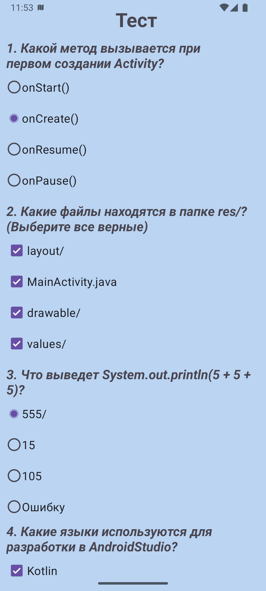
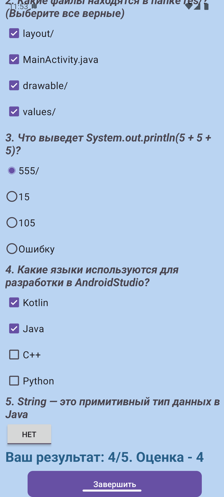

# Android Development Quiz

Приложение-тест для проверки базовых знаний по Android-разработке.

## Скриншоты

  
  

## Стек
- Java, XML

## Что реализовано
- Верстка формы с различными вводами ответа
- Сбор данных от пользователя и проверка правильности ответов
- Подсчет баллов и вывод итоговой оценки